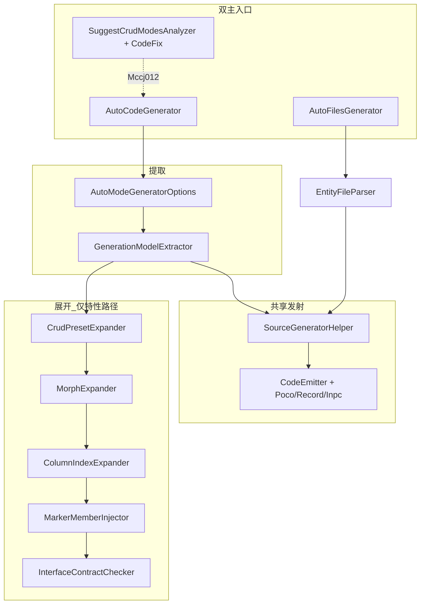

# 架构说明（维护者）

面向仓库维护者：消费方请看 [Analyzers README](../src/AutoModeCodeGenerator.Analyzers/README.md)。当前版本 **1.0.1.0**。

## 双主入口

本库有两条并列的主入口，最终共用同一 Emit：

| 入口 | 规格来源 | 典型产物 |
|------|----------|----------|
| **A. 特性** | 接口/类 + `AutoCodeCrudModes`（及 Relation / Morph / Column…） | 多产物 CRUD POCO（SqlSugar / Admin.NET 等） |
| **B. entity.json** | AdditionalFiles 中的 `.entity.json` | 声明式 POCO / Record / Inpc |

```text
规格接口 + mixin / CrudModes…  →  Extract / Expand  →  Emit
.entity.json                   →  EntityFileParser →  Emit（同套发射器）
```

入口 B **当前不经** CrudModes / Relation / Morph / Column / Inject 展开器；多 mode 与 ClassStyle 在 JSON 内直接声明。能力边界如实，不当成「次要路径」。

消费目的与优势见 [AI_CONSUMER_GUIDE.md §0](AI_CONSUMER_GUIDE.md#0-30-%E7%A7%92%E5%AE%9A%E4%BD%8D)。

## 管线概览



| 阶段 | 职责 | 主要类型 |
|------|------|----------|
| **PostInit** | 注入公共 API（特性 / 常量 / Inpc 基类） | `EmbeddedTemplates` → `AutoCodeAttribute.g.cs` |
| **Extract** | 语义模型 → 中间模型 + 诊断（入口 A） | `GenerationModelExtractor` |
| **Expand** | 预设 / Relation / Morph / Column / 注入（入口 A） | `*Expander`、`MarkerMemberInjector` |
| **Parse** | entity.json → 中间模型（入口 B） | `EntityFileParser` |
| **Emit** | 中间模型 → C# 源文本（共享） | `SourceGeneratorHelper`、`CodeGeneration/*` |

## 项目内分层

```
AutoModeCodeGenerator.Analyzers/
├── AutoCodeGenerator.cs              # 入口 A：特性驱动
├── AutoFilesGenerator.cs             # 入口 B：.entity.json
├── Extraction/                       # 语义 → 中间模型
│   ├── GenerationModelExtractor.cs   # 编排 Extract + Expand
│   ├── AttributeArgumentReader.cs    # 特性参数解析（唯一实现）
│   ├── GenerationModels.cs           # ClassModeInfo / mode 常量
│   ├── SourceGeneratorInfo.cs        # Emit DTO
│   └── AutoModeGeneratorOptions.cs   # MSBuild 选项
├── Expansion/                        # 仅入口 A
│   ├── CrudPresetExpander.cs         # CrudModes + Relation（六模式构建）
│   ├── MorphExpander.cs
│   ├── ColumnIndexExpander.cs
│   ├── MarkerMemberInjector.cs
│   └── InterfaceContractChecker.cs   # Mccj011
├── CodeGeneration/                   # 共享 Emit
│   ├── SourceGeneratorHelper.cs
│   └── Poco / Record / Inpc emitters
├── EntityFiles/                      # 入口 B 解析
├── Diagnostics/                      # GeneratorDiagnostics、Mccj012 Analyzer/CodeFix
├── Templates/                        # 仅 AutoCodeAttributes.cs（嵌入资源，不参与 Compile）
├── EmbeddedTemplates.cs              # 读取嵌入模板的工具（分析器侧）
└── build/*.props
```

- **公共命名空间（消费方）：** `AutoCodeGenerator`（随 PostInit 注入；SuggestCrudModes* 亦在此 ns）
- **内部命名空间：** `AutoModeCodeGenerator.Internal`（及 `.CodeGeneration` / `.EntityFiles`）；文件夹按管线分组，类型 ns 未再拆分以免破坏内部引用
- **测试：** `InternalsVisibleTo` → `AutoModeCodeGenerator.Tests`

## 中间模型约定

- **Mode Id** 字符串与嵌入模板 `AutoCodeCrud` 对齐，生成器侧常量见 `AutoCodeModeIds`（无法直接引用 PostInit 类型）。
- **位标志** `AutoCodeModeFlagBits` / `AutoCodeMorphKinds` 必须与模板枚举数值一致；改模板时同步改镜像常量。
- **手写 ClassModes 与 CrudModes：** 同一 `Id` 时手写覆盖预设（`MergeModes`）。1.0.1 起 `AutoCodeClassModes` / `*Str` 等带 `[Obsolete]`（`error: false`），行为保留。

## 诊断归属

| ID | 产生位置（约） |
|----|----------------|
| Mccj001–008 | Extractor / 历史规则 |
| Mccj009–010 | InheritStr / Attributes 校验 |
| Mccj011 | `InterfaceContractChecker` |
| Mccj012 | `SuggestCrudModesAnalyzer`（可 CodeFix） |
| Mccj013 | Index 列 vs Entity 绑定 |
| Mccj014 | Relation 缺 `TargetName` |

## 改代码时注意

1. **特性解析**只改 `AttributeArgumentReader`；不要在 Expander 里再写一套 `GetValue`。
2. **新 mode Id / 标志位**同时改 `Templates/AutoCodeAttributes.cs` 与 `Extraction/GenerationModels.cs`。
3. **行为变更**写 `CHANGELOG.md`；诊断变更走 `AnalyzerReleases.*.md`。
4. **不要**在主包引用 SqlSugar.dll；ORM 仅通过字符串模板。
5. **双入口**：改 Emit 须同时考虑特性路径与 entity.json；Expand 仅影响入口 A。

## 相关文档

| 文档 | 用途 |
|------|------|
| [AI_CONSUMER_GUIDE.md](AI_CONSUMER_GUIDE.md) §0 | 消费目的 / 架构 / 优势（Agent 真源） |
| [ROADMAP.md](ROADMAP.md) | 1.0.1 之后建议与非目标 |
| [IMPROVEMENT_PLAN.md](IMPROVEMENT_PLAN.md) | 阶段 A–I 历史完成记录 |
| [PACKAGING.md](../src/AutoModeCodeGenerator.Analyzers/PACKAGING.md) | 发包 |
